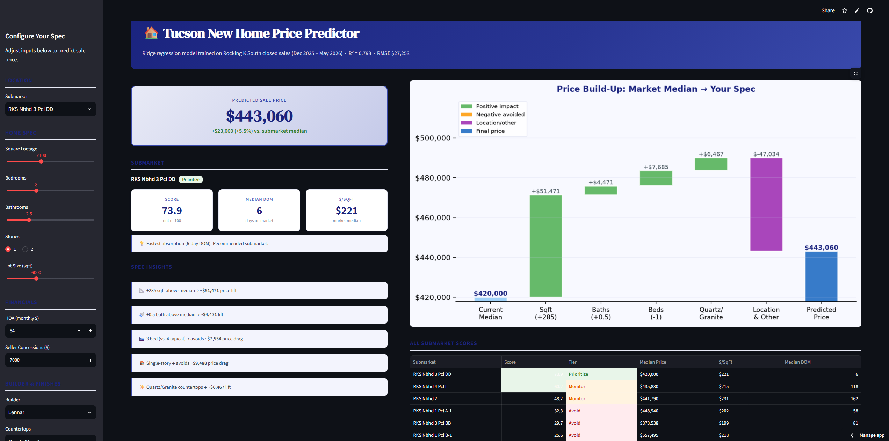
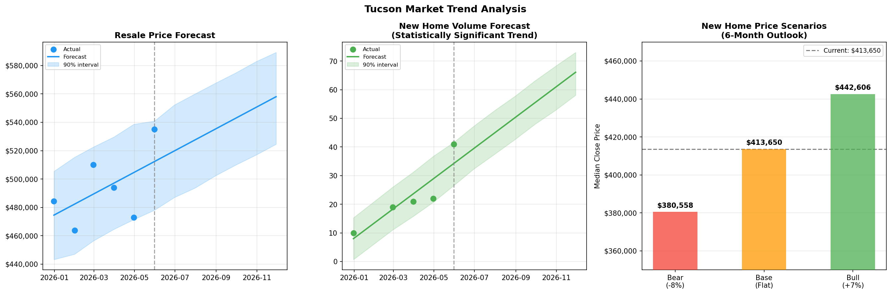
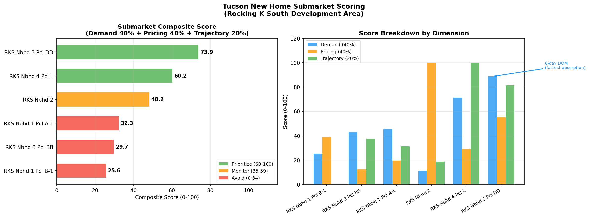
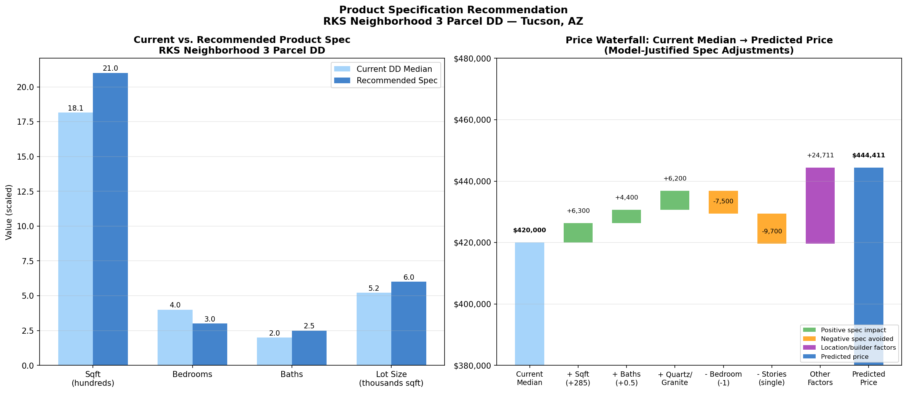

# Tucson New Home Market Analysis & Price Predictor

> End-to-end data science project analyzing the Tucson, AZ residential real estate market for a new home builder — covering data cleaning, feature engineering, price prediction modeling, trend forecasting, and site/product recommendation.

🚀 **[Live Demo — Interactive Price Predictor](https://treesebranches-tucson-home-price-predictor-app.streamlit.app)**



---

## Project Overview

This project answers three core questions for a Tucson-area home builder:

1. **Where should we build?**  Submarket scoring across Rocking K South development parcels
2. **What should we build?**  Product specification recommendation backed by model feature importances
3. **What should we price it at?**  Ridge Regression price prediction for any given spec/location combination

**Data:** 354 resale + 124 new home closed sales, December 2025 – May 2026, Tucson, AZ  
**Tools:** Python, pandas, scikit-learn, XGBoost, Prophet, Streamlit, matplotlib, seaborn

---

## Key Results

| Metric | Value |
|---|---|
| New home model (Ridge Regression) R² | 0.793 |
| New home model RMSE | $27,253 |
| Resale model (XGBoost) R² | 0.849 |
| Resale model RMSE | $79,233 |
| Improvement over naive baseline | >60% |
| Models compared per dataset | 4 |
| Statistically significant trend found | New home volume (+6.5 closings/month, p=0.033) |

---

## Repository Structure

```
tucson-housing-analysis/
├── README.md
├── requirements.txt
├── notebook/
│   └── end-to-end-tucson-housing-price-regression.ipynb   ← full analysis
├── data/
│   └── TucsonDataClean.xlsx                               ← raw data
├── models/
│   ├── new_home_ridge.pkl                                 ← production model
│   ├── new_home_rf.pkl
│   ├── new_home_xgboost.pkl
│   ├── new_home_scaler.pkl
│   ├── new_home_feature_config.pkl
│   ├── resale_ridge.pkl
│   ├── resale_rf.pkl
│   ├── resale_xgboost.pkl
│   └── resale_scaler.pkl
├── visuals/
│   ├── trend_analysis.png
│   ├── trend_summary.png
│   ├── prophet_forecasts.png
│   ├── scenario_chart.png
│   ├── submarket_scoring.png
│   └── product_recommendation.png
├── streamlit_app/
│   └── app.py
└── outputs/
    ├── new_homes_clean.xlsx
    └── resale_clean.xlsx
```

---

## Methodology

### 1. Data Foundation
- Cleaned and merged new home and resale datasets from MLS listings
- Parsed semicolon-delimited `Features` field (290 raw attributes → 28 useful columns)
- Extracted boolean amenity flags from unstructured `Public Remarks` text
- Consolidated rare categorical values (subdivision, builder) to prevent small-sample overfitting
- Applied time-based train/test split (80/20) to simulate real prediction conditions

### 2. Price Prediction Models
Four models compared per dataset (Linear Regression, Ridge, Random Forest, XGBoost):

**New Homes** (n=99 training rows):
- Production model: **Ridge Regression** (R²=0.793, RMSE $27,253)
- Key finding: regularized linear models outperform tree-based methods at this sample size
- Tree-based methods underperformed due to insufficient data for ensemble averaging
- Added cross validation on 5 folds that reflects small-sample instability

**Resale Homes** (n=280 training rows):
- Production model: **XGBoost** (R²=0.849, RMSE $79,233)
- Key finding: tree-based models outperformed linear at 280 rows, confirming sample size as the key determinant of model class selection
- Bath count emerged as the strongest independent price driver (r=0.51 with sqft, confirming genuine signal rather than proxy)

### 3. Trend Forecasting



- Linear trend analysis with p-values for both price and volume
- Only statistically significant finding: new home volume accelerating at +6.5 closings/month (p=0.033)
- Prophet forecasting applied where defensible (resale price, new home volume)
- Prophet rejected for new home price forecasting — 5 data points insufficient for reliable extrapolation; replaced with scenario analysis (bear/base/bull)

### 4. Site & Product Recommendation



- Submarket scored across three dimensions: demand strength (40%), pricing power (40%), volume trajectory (20%)
- **Top submarket: RKS Neighborhood 3 Parcel DD** (composite score 73.9/100) — 6-day median DOM, lowest in dataset
- All Rocking K South submarkets are 19-37 miles from nearest resale competition — zero direct competitive pressure
- Recommended spec: 2,100 sqft / 3 bed / 2.5 bath / single story / Quartz-Granite countertops
- Predicted price: **$444,411** (+5.8% premium over submarket median)

### 5. Product Specification Recommendation


---

## Key Analytical Findings

**Sample size determines model class.** On new homes (n=99), Ridge Regression tied or beat XGBoost. On resale (n=280), XGBoost clearly won. This empirical validation of the bias-variance tradeoff across two real datasets is one of the project's strongest methodological insights.

**New home buyers and resale buyers weight different features.** New home price is driven by builder identity, HOA structure, and lot size. Resale price is driven by bath count, sqft, year built, and community identity. Builders should compete on product specification and HOA value proposition — not brand alone.

**Volume is a leading indicator, price is lagging.** New home transaction volume is accelerating significantly (p=0.033) while prices remain under pressure — a classic early-recovery signal. Demand is returning before prices have responded.

**Pricing discipline within a submarket matters more than submarket selection.** RKS Neighborhood 3 Parcel DD has a 6-day median DOM, but a 328-day maximum — homes priced correctly sell instantly, mispriced homes sit for nearly a year. The right product at the right price is more important than location alone within this development area.

---

## Limitations

- 6 months of data limits trend forecasting reliability, 12-18 months required for seasonal analysis
- New home sample (n=124) constrains model complexity and increases sensitivity to individual outliers
- Amenity flags derived from listing remarks undercount actual features in new construction listings
- All Rocking K South submarkets are geographically clustered, findings may not generalize to other Tucson development areas

---

## Running Locally

```bash
# Clone the repo
git clone https://github.com/Treesebranches/tucson-housing-market-analysis.git
cd tucson-housing-market-analysis

# Install dependencies
pip install -r requirements.txt

# Launch the Streamlit app
cd streamlit_app
streamlit run app.py

# Or open the full notebook
jupyter notebook notebook/end-to-end-tucson-housing-price-regression.ipynb
```

---

## Tech Stack

| Category | Tools |
|---|---|
| Data manipulation | pandas, numpy |
| Machine learning | scikit-learn, XGBoost |
| Time series | Prophet |
| Visualization | matplotlib, seaborn |
| App deployment | Streamlit |
| Model persistence | joblib |

---

*Built by Austin Treese · [GitHub](https://github.com/Treesebranches)*
